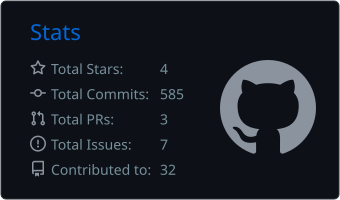
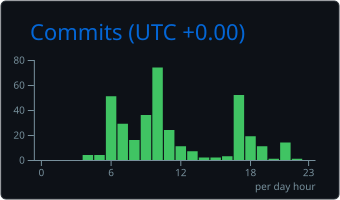
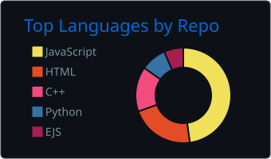
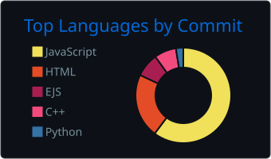
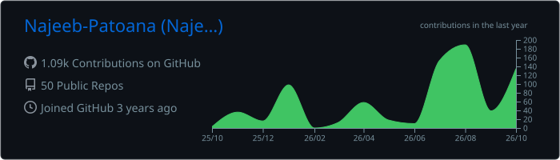

<h1 align="center">Hi 👋, I'm Najeeb Ullah Khan</h1>

<h3 align="center">AI / Full-Stack Software Engineer | LLMs, RAG & Web Automation</h3>

  
  
  

  I am a Software Engineering graduate building AI-powered platforms, RAG systems, browser automation, and production-grade full-stack applications. With a background in teaching Computer Science, I focus on delivering clean, resilient, and well-documented solutions.

---

### 🚀 What I'm Up To

- 🔭 **Currently working on:** AI-powered products with RAG pipelines, LLM APIs, and vector databases (Qdrant), including meeting intelligence, brand-content generation, and legal research assistants.
- 🌱 **Currently expanding my skills in:** LLM orchestration with LangChain and advanced DevOps (Docker, Jenkins, CI/CD pipelines).
- 💡 **I love building:** AI/RAG applications, web-automation pipelines, robust database-driven platforms, and embedded systems.
- 💬 **Ask me about:** RAG, LangChain, React, Node.js, FastAPI, Playwright/Selenium, and optimizing system architectures.
- 📫 **How to reach me:** [najeebpatoana007@gmail.com](mailto:najeebpatoana007@gmail.com)

---

### 🏆 Featured Projects

| Project | Description | Tech Stack |
| :--- | :--- | :--- |
| [⚖️ **Vector Law**](https://github.com/Najeeb-Patoana/Vector-Law-Legal-Chatbot) | RAG-based legal research assistant with citation-grounded answers, cross-encoder reranking, and a Gemini → OpenAI → Groq fallback chain. | `Node.js`, `React`, `Supabase`, `Qdrant` |
| [☀️ **Solar Planner**](https://github.com/Najeeb-Patoana/Solar-Planner) | Full-stack AI platform using SAM for rooftop detection, OCR for electricity bill analysis, and Selenium for automated bill retrieval. | `MERN`, `Python`, `SAM`, `Selenium`, `Docker` |
| [📄 **Smart PDF ChatBot**](https://smart-pdf-chat-bot.vercel.app) | RAG-based document Q&A with document-scoped vector retrieval and embedding reuse across follow-up queries. | `Node.js`, `React`, `Qdrant`, `Gemini` |
| [📡 **Hardware Telemetry System**](https://github.com/Najeeb-Patoana/SolarPlanner-DualEnergyMonitor) | Dual-channel AC energy monitoring system built on ESP32-S3 with two PZEM-004T sensors. | `ESP32-S3`, `C++`, `IoT` |
| [🔍 **Code Sniffer**](https://github.com/Najeeb-Patoana/Code-Sniffer) | Static analysis tool that detects seven JavaScript code smells using Abstract Syntax Trees (ASTs). | `JavaScript`, `AST` |

---

### 🛠️ Languages and Tools

  
  
  

  

---

### 📊 Developer Activity

  
  

### 📊 Top Languages

  
  

  

